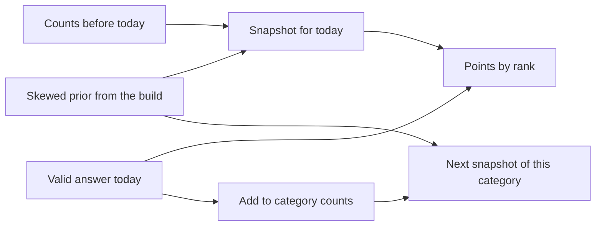

# Genshin daily rarity game

## How rarity works before anyone has played

Score each answer by how **surprising it is among valid answers for that category**, not by a global “this character is obscure” number. Kaeya is common for “Name a Cryo character” and would be rare for a narrower prompt.

Krillion does not actually wait for today’s players. New or thin categories need a **prior**. Live voting on day one is also unfair: the first players would all look rare, and the same answer would change score as the day goes on.

Use one distribution per **reusable category** (example key: `character|element=Cryo`), shared every time that category appears.

**Prior (day zero).** Give every valid answer a salience weight, normalize to shares that sum to 1, and skew them. A flat prior makes every Cryo character look equally rare, which is not fun. Higher salience means “people will type this,” which means **fewer points**.

- Playable characters: [`data/popularity.csv`](data/popularity.csv). Weight is `ownershipScale × owned + usage + 4 × votes × (89211 / 1243707)`. Ownership and usage are counts out of 89,211. A 4-star's ownership counts half, because 4-stars are much easier to obtain; usage is not discounted. The 2025 poll is 1,243,707 votes, scaled into that sample and then multiplied by 4 so fame is a real term. A blank vote adds nothing. Star rating alone is a bad proxy: Bennett is guessed far more often than many 5-stars.
- Everything else: structural salience from the catalog. Capitals and early regions above obscure viewpoints, 4-star and 5-star items above 1-star, archon-adjacent groups above niche ones. Weapons and artifacts use star rating, a U-shaped release version (launch and current versions above the middle of the timeline), and a short-name bonus of at most 12%.
- A category can multiply those weights in [`data/weights.json`](data/weights.json). The file is keyed by category key, then answer id. Unlisted answers keep their base weight. A higher multiplier means people will type that answer for that prompt. The build reads the file and does not rewrite it.

**Blend (once answers exist).** Additive smoothing, with the prior worth `K = 80` virtual answers, and a floor of half the prior share (`PRIOR_FLOOR = 0.5`):

```text
smoothed = (count + K * priorShare) / (total + K)
share    = max(smoothed, PRIOR_FLOOR * priorShare)
```

At 0 real answers the share is the prior. Around 80 answers, prior and players are equal. After a few hundred, players dominate **upward only**. An answer players pick more often than the prior expected can rise without limit. An answer they pick less often stops at half its prior share. Example, after 400 answers:

- A sleeper with a 2% prior, picked by 30% of players: `(120 + 1.6) / 480` ≈ 25%. Players win.
- An obvious answer with a 20% prior, picked by 2.5% of players: `(10 + 16) / 480` ≈ 5.4%, floored to 10%. The prior holds.

The floor only bites once `total` passes 80. Up to that point, even an answer nobody picks keeps at least half its prior.

The floor exists because rarity scoring teaches players to avoid obvious answers. Without it, enough players skipping Bennett would make Bennett rare, and the next snapshot would pay top points for the most obvious Pyro character. One day of herding, such as a streamer's audience all avoiding the same name, would have the same effect. Points come from rank, so the floor matters in one way: an obvious answer cannot fall below answers whose blended share is under half its prior.

Submissions are counted only if the answer is valid, one per browser per prompt per day.

**Stable daily score.** When the puzzle is published, snapshot each category’s shares. Everyone that day is scored from that snapshot. Today’s submissions update counts for the **next** time the category is drawn. The result card says “Estimated from popularity” when `total < 80`, and “Based on N answers” after that.

Map shares to points by **percentile within the category**, not by a fixed share cutoff. A fixed cutoff breaks on size: in an 8-answer category nothing falls below 1.5%, and in a 60-answer category nearly everything does. Rank the category's answers by snapshot share. An answer's percentile is the fraction of answers ranked above it. Bands: below 10% → 10, below 45% → 30, below 80% → 60, the rest → 85. 30 and 60 are the widest bands, so most answers land in the middle. The bands live in `POINT_BANDS` in [`lib/scoring.ts`](lib/scoring.ts) so they can be tuned.

Ranking never awards 100. 100 is a hand-picked bonus for an answer worth celebrating, listed per category in [`data/bonus-answers.json`](data/bonus-answers.json) (category key → answer ids). Bonus answers leave the ranking, and the rest are ranked as usual. The build reads that file and does not rewrite it. It copies the list into each category as `bonusAnswerIds`. A bonus stays at 100 no matter how often players type it. Bonuses are kept apart from [`data/weights.json`](data/weights.json) because weights change how likely an answer is, while a bonus only changes its points.

Every category must have at least one answer at 10, 30, 60, and 85. With at least 8 ranked answers and no ties, the bands guarantee this. Equal shares always get equal points. If ties leave a required tier empty, the scorer ranks distinct share levels instead, which works whenever the category has at least 4 distinct shares. The catalog build fails on any category whose prior cannot fill the four tiers. Points come from the frozen snapshot, so they stay fixed all day.

The prior never changes after the build. Each snapshot is computed fresh from the prior plus the counts stored up to that moment:



## Game loop

Match the part of Krillion you described, on a shared UTC daily puzzle:

- 7 prompts, same for everyone that date.
- One accepted answer each. 25 seconds. No multiple choice. The player keeps typing until an answer is accepted or the timer runs out. A timeout scores 0 and moves to the next prompt.
- Server checks the answer against that prompt’s accepted set only, including aliases (`Hu Tao`, `Hutao`). A player sees one prompt at a time, so the same text can mean different answers on different prompts: `Honorary Knight of the Knights of Favonius` is the Traveler on a character prompt and its own answer on a title prompt. [`lib/matcher.ts`](lib/matcher.ts) returns one of four results. Only **matched** is accepted. `attemptFeedback` turns the result into the API response:

  | Result | When | Response |
  |---|---|---|
  | **matched** | An exact name or alias, or a corrected typo | Accepted. Scored, recorded, counted toward rarity, and the player moves on. `typo: true` lets the result card say "Counted as Bennett". |
  | **ambiguous** | An alias two of this prompt's answers share, such as `Slumber Party` on an Inazuma prompt | "Be more specific" |
  | **off-prompt** | An exact name from the catalog that is not an answer here | "Doesn't count for this prompt" |
  | **unknown** | Anything else | "Not recognized. Check the spelling" |

  A rejected attempt keeps the player on the prompt with the clock still running. It is not recorded, not counted toward rarity, and carries no answer ids, so it cannot leak the accepted set. The messages live in `REJECT_MESSAGES`. Wrong guesses cost nothing but time, so the 25-second deadline must be enforced on the server: the puzzle route records when each prompt was served, and the answer route rejects attempts after the deadline.
- Typos are corrected only for near misses: none for names under 5 letters, 1 edit for 5 to 8, 2 edits for 9 or more. A swap of two neighbouring letters is one edit. The closest answer must be the only one at that distance, and no name outside the prompt can be as close, so a misspelled wrong answer is never corrected into a right one.
- One optional hint per day reveals three accepted answers from different point bands, without listing the set.
- End screen totals points. Streak and today’s answers stay in `localStorage`. The server only needs an anonymous player id cookie.

The client never receives the full accepted list.

## Data

[`genshin-db`](https://github.com/theBowja/genshin-db) already has characters, weapons, artifacts, food, enemies, viewpoints, achievements, and namecards, with fields like element, weapon type, region, and star rating. A build script imports it into a local catalog and expands **prompt templates** whose accepted set has at least 8 answers(smaller sets have no rarity spread).

Examples: “Name a Cryo character”, “Name a Claymore user from Liyue”, “Name a 4-star food”, “Name a viewpoint in Inazuma”.

Quests and soundtrack **titles** are not in that dataset. They ship in a second curated JSON file, text only. Do not bundle official images, voice lines, or music files. Names and mechanical facts are enough for a fan game; add a short unofficial-fan-project note in the footer.

The daily picker is a date-seeded shuffle. It prefers categories that either have a skewed prior or at least 80 real answers, and it avoids repeating the same entity type seven times.

## Adding a question

A daily question is a reusable category. The build writes it into [`data/categories.json`](data/categories.json). Do not hand-edit that file. The next catalog build replaces it. Scoring, the daily snapshot, and points already apply to every category, so a new question does not get its own scorer.

1. **Write the prompt and the accepted set.** One accepted typed answer, no multiple choice. The set needs at least **8** answers. Fewer than 8 has no rarity spread.
2. **Give every answer its own id and canonical name** in a source the build reads. Generated sets come from genshin-db filters such as `character|element=Cryo`. Every other question lives in [`data/extra-categories.json`](data/extra-categories.json), with any kind of answer. Each category has a `key`, a `prompt`, and an `answers` list. The build reads that file and does not rewrite it. Each answer is one of three forms:

   ```json
   "answers": [
     "character:albedo",
     { "id": "character:kaeya", "weight": 5 },
     { "id": "title:honorary-knight", "name": "Honorary Knight of the Knights of Favonius", "weight": 8, "aliases": ["Honorary Knight"] }
   ]
   ```

   - **An id string** is an existing answer at its usual weight: survey or gear weight for genshin-db entities, defined weight for answers defined in this file.
   - **`{ id, weight }`** is an existing answer with a hand weight for this category only.
   - **`{ id, name, weight, aliases? }`** defines a new answer that genshin-db does not have. The id is `type:slug` in lowercase, and the part before the colon becomes its type (`title`, `quest`, `npc`, anything). It cannot reuse a genshin-db id. Define it once, then list it by id string in other categories. The build adds it to the catalog and its aliases to [`data/aliases.json`](data/aliases.json).

   A category can mix types. Its `entityType` is the shared type, or `mixed`. A category cannot mix hand weights with computed weights, because survey weights are in the tens of thousands and hand weights are 1 to 8. If any answer is hand-weighted, give every answer in that category a weight; the build fails otherwise.

   An entity can also count for an extra field value, such as a second region, through [`data/exceptions.json`](data/exceptions.json). The catalog value stays, and every generated filter for the extra value includes that entity. The build reads that file and does not rewrite it. `character:traveler` and `title:honorary-knight` are different answers.
3. **Give every answer a salience weight, then let the build turn weights into shares.** Shares for one category sum to 1. A higher weight means people will type it, which means fewer points. The weights must be skewed: the average weight of the most likely quarter of answers at least 1.65 times the average of the least likely quarter (a quarter is ⌈n/4⌉ answers). Comparing quarters instead of the single top and bottom answer means one standout cannot make a flat list pass. A flat list makes every answer look equally rare.
   - Characters use [`data/popularity.csv`](data/popularity.csv): `ownershipScale × owned + usage + 4 × votes × (89211 / 1243707)`. 5-star ownership counts in full. 4-star ownership counts half.
   - Weapons and artifacts use star rating, a U-shaped release version (early and recent above the middle), and a name-length bonus of at most 12%.
   - A list with no survey, such as Traveler titles, gets a short hand ranking in the `weight` of each answer in [`data/extra-categories.json`](data/extra-categories.json). Use at least four buckets, because points need at least 4 distinct shares to fill the 10, 30, 60, and 85 tiers: names everyone types, titles many players have seen, titles some players remember, and the obscure rest. Example weights 8, 4, 2, and 1. Share is `weight / sum`.
   - To change one answer inside one category, put a multiplier in [`data/weights.json`](data/weights.json). `3` triples that answer's base weight for that prompt only.
   - To make an answer worth 100 on one prompt, list it under that category key in [`data/bonus-answers.json`](data/bonus-answers.json). The other answers still need at least 4 distinct shares.
4. **Add aliases only for names that stay different after normalization.** The matcher strips case, spaces, and punctuation, so `Hu Tao` and `Hutao` do not need two entries. Hand-written aliases go in [`data/extra-aliases.json`](data/extra-aliases.json), keyed by entity id. The build merges that file into [`data/aliases.json`](data/aliases.json) and does not rewrite the hand-written file. An alias counts only when that answer is in the prompt. `Kazuha` does not match Kaedehara Kazuha on a prompt that does not include him.
5. **Do not put a list of separate answers on one id.** Aliases collapse to a single share. "Name a title of the Traveler" needs one id per title, each with its own weight. `Aether` can still sit on `character:traveler` so that name counts as the Traveler on character prompts. Those are two uses of the same word.
6. **Rebuild the catalog.** `npm run build:catalog` rewrites the catalog, aliases, and category shares. The daily picker can draw the category once the prior is skewed, or after 80 real answers if the prior is flat. It will not use the same entity type for all seven prompts.

After people play, new guesses blend with the prior. The prior is worth 80 virtual answers, and an obvious answer never falls below half its prior share. Today's guesses update the next snapshot, not today's points.

## App shape

Empty repo. One Next.js app: React UI through the App Router, TypeScript, and Tailwind. The API is Next.js route handlers in that same app. There is no separate Fastify or Express server.

Run it as a long-lived Node server (`next start`), not a serverless host. The SQLite file has to stay on disk between days so rarity counts and the daily snapshot survive a restart. Drizzle is the query layer over that file.

- [`scripts/build-catalog.ts`](scripts/build-catalog.ts) writes the catalog, aliases, and prior shares.
- [`lib/scoring.ts`](lib/scoring.ts) is the blend, tier map, and snapshot rule. Unit-tested without the UI.
- [`lib/matcher.ts`](lib/matcher.ts) resolves typed text to one of the prompt's answers. Build the name index once from the catalog and aliases at server start. Unit-tested without the UI.
- [`lib/puzzle.ts`](lib/puzzle.ts) builds the 7 prompts from the UTC date.
- [`app/api/puzzle/route.ts`](app/api/puzzle/route.ts) returns prompts only.
- [`app/api/answer/route.ts`](app/api/answer/route.ts) matches the text against the prompt, returns `attemptFeedback`, and stops there on a rejection. On an accepted answer it scores from the snapshot, records the submission, then increments counts. A prompt that already has an accepted answer from this player rejects further attempts.
- SQLite via Drizzle ([`db/schema.ts`](db/schema.ts)): `category_counts(categoryKey, answerId, count)`, `daily_snapshots`, `submissions(playerId, date, promptIndex, answerId)`.
- [`app/page.tsx`](app/page.tsx): prompt, timer, input, result tier, progress, final total.

Playable v1 is characters plus the other genshin-db folders the importer can turn into templates. Quest and track titles are the following data drop, using the same scorer. No accounts or global leaderboard in v1; the cookie is only there so one browser cannot stuff the rarity counts.

## Why these tools

**React** is the page.

- The game is one screen whose contents change every few seconds: the prompt, the timer, the result, and the running total.
- Typing and the countdown stay in the browser, so the page updates without a new server render.
- The streak and today's finished prompts are read from `localStorage` when the page opens.
- After a `POST` returns, the same screen shows the tier and then the next prompt.

**Next.js** is the server around that page.

- The React page and the API ship as one app, started with `next start`.
- Route handlers are where the accepted answer lists stay. The browser only receives prompt text.
- `GET /api/puzzle` and `POST /api/answer` map directly to files in the App Router.
- That one process is what keeps the SQLite file open across days.
- The catalog import runs at build time, before the server is deployed.

**TypeScript** is the shared language.

- Entities, category keys, snapshots, and the answer response are fixed shapes passed from the catalog to the API to the page.
- The share formula and the point thresholds take specific numeric inputs, and the types keep those inputs from drifting.
- The Drizzle tables and the route handlers describe the same rows.
- A bad guess, a timeout, and a scored answer can share one result type.

**Tailwind** is the styling.

- There is a single page with a handful of visual states: prompt, result, hint, and the final total.
- The timer and the result card change appearance from the game state, and the styles sit next to that markup.
- The layout is small enough that it does not need a separate CSS architecture.
- The fan-project footer and the daily layout can be built with the same utility classes.

**SQLite** is the database.

- The stored data is three tables: counts, daily snapshots, and submissions.
- Those rows have to still be there tomorrow, on the same disk as the server.
- One Node process is the only writer, which matches a single database file.
- A valid answer does one increment. The catalog itself is JSON, not rows.

**Drizzle** is how the server talks to that file.

- The three tables are defined in TypeScript beside the route handlers.
- The snapshot read, the submission insert, and the count increment are queries in that layer.
- Scoring stays in `lib/scoring.ts`, and the route handler only asks Drizzle to load and save rows.
- The same table definitions can move to PostgreSQL if the app ever runs on more than one server.

**genshin-db** is the source of the catalog.

- It already has characters, weapons, artifacts, food, enemies, viewpoints, achievements, and namecards.
- Element, weapon type, region, and rarity are the fields the category templates filter on.
- Names and aliases come from that data, so `Hu Tao` and `Hutao` resolve without a hand-written list for every character.
- The build script copies it into a local catalog, so a player's request never calls an outside API.
- Quest and soundtrack titles are not in that dataset, so those two categories stay in a curated JSON file and use the same scorer.